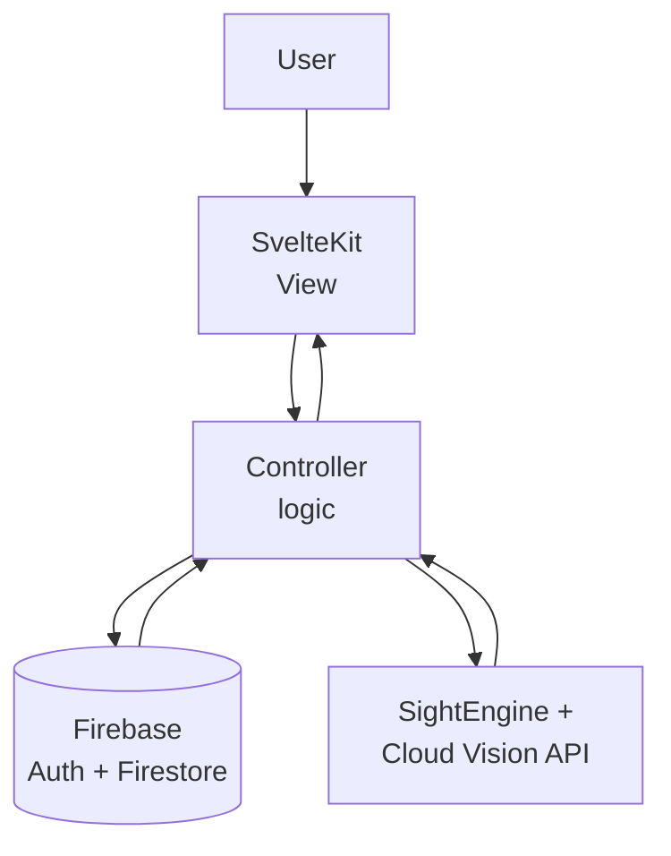

# Plato

A web application that matches mentors with mentees in a community of professional users. Built over two semesters as the CS 425/426 Senior Project at the University of Nevada, Reno.


**[Demo video](https://www.youtube.com/watch?v=cVx3tBaflXY)** · **[Project site](https://aboutplato.wordpress.com/)** · **[Full documentation](https://aboutplato.wordpress.com/docu/)**

---

## The problem

76% of people say mentorship matters. Only 37% actually have a mentor.

Finding a mentor whose background matches what you're trying to learn usually depends on already knowing the right people. Plato closes that gap by matching on profile data instead of existing networks, so the connection doesn't depend on who you already know.

---

## What it does

- **Profile-based matchmaking.** Mentors and mentees build detailed profiles, and the matching logic uses that data to suggest connections rather than leaving users to search blindly.
- **Direct messaging.** An in-app chat so matched users can talk without exchanging personal contact details.
- **Connection management.** Users add and disconnect connections as relationships change.
- **Local professional events.** A feed of nearby professional events, so the platform is useful between conversations.
- **Identity verification and MFA.** Both required, because a mentorship platform only works if people trust who they're talking to.
- **Automated content moderation.** SightEngine and Google Cloud Vision API screen uploaded content and flag unprofessional behavior without a human reviewing every upload.

---

## Architecture

Plato follows an MVC pattern. User input hits the View, the Controller processes it and updates the Model, and the View re-renders from the updated data.



**Frontend:** SvelteKit. Chosen early in Fall 2023 for its build output and the smaller runtime compared to heavier frameworks.

**Backend:** Firebase. Handles authentication, the database, and storage through the Firebase API. For a four-person team on a two-semester timeline, not running our own server was the right tradeoff.

**Moderation:** SightEngine and Cloud Vision run against uploaded images to catch content that violates the platform's professional standard.

---

## My contribution

I designed and implemented the matchmaking logic — the system that reads profile attributes and scores potential mentor-mentee pairings. That meant coordinating across the front end (how profile data gets collected), the back end (how it's stored and queried in Firebase), and the matching layer itself.

FILL: 2-3 more specific sentences. What attributes did you match on? Was it weighted scoring, filtering, similarity? What was the hardest part — sparse profiles, cold start, tie-breaking? This is the section an interviewer will ask about, so make it concrete.

---

## Engineering process

- Requirements specification with functional and nonfunctional requirements, use case modeling, and a traceability matrix
- High-level, medium-level, and detailed design documents
- User stories with acceptance criteria, a defined testing workflow and strategy, and unit tests
- Accessibility review covering visual, hearing, and cognitive conditions
- Ethical and legal review alongside risk assessment and project monitoring
- Live demos to instructors and to the full senior project class, with feedback folded back into the build

Every deliverable is public on the [documentation page](https://aboutplato.wordpress.com/docu/).

---

## Sontag Business Competition

Team Plato entered the UNR College of Business Sontag Competition and advanced to round two, presenting on market, competitive advantage, revenue model, and customer validation. We wrote a business model canvas and a 1,000-word abstract on the path to profitability.

Worth noting because it forced a question most class projects never ask: would anyone actually pay for this?

---

## Repo structure

```
├── .vscode/
├── plato/          # SvelteKit application
└── README.md
```

FILL: expand this once you've looked inside `plato/` — routes, components, lib, and wherever the matchmaking code lives. Pointing a reader straight at your matchmaking file is the highest-value thing you can do here.

---

## Running it locally

```bash
git clone https://github.com/Mamaril-Jeremy/CS425-Project.git
cd CS425-Project/plato
npm install
npm run dev
```

## Limitations

- Matching quality depends on how thoroughly users fill out profiles. Sparse profiles produce weak matches, and there's no fallback for a brand new user with almost no data.
- The moderation APIs catch image-based violations well but do less for text.
- Never deployed past the academic demo, so it hasn't been tested with real concurrent users.

---

## Team

CS 425/426 Senior Project, Team 19 · Fall 2023 – Spring 2024

Richard Cao · Jeremy Mamaril · Mark Marsala · Michael Nia

**Instructors:** Dave Feil-Seifer, Devrin Lee, Sara Davis
**External advisor:** Dr. Farnaz Hosseinpour

---

## Tech stack

**Frontend:** SvelteKit, HTML, CSS, JavaScript
**Backend:** Firebase (Authentication, Firestore, Storage)
**ML / moderation:** SightEngine, Google Cloud Vision API
**Tooling:** Git, VS Code
